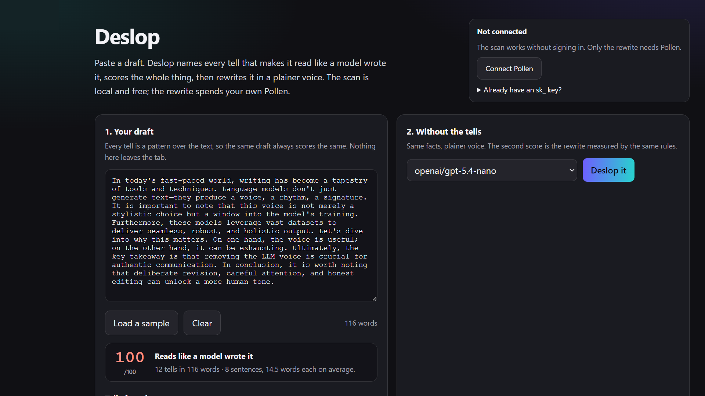

[](https://pollinations.ai/?ref=badge)

# Deslop

Find the LLM voice in a draft, then take it out. Live app:
**https://rekty.github.io/deslop/**



Every model has a voice. It is the rise and fall you can hear before you know what the text says:
the "not just X, but Y" frame, the em dash where a comma belongs, the rule of three, the paragraph
that ends by summarising itself, the word *delve*. Deslop does two things with it — it **names the
tells in your own draft**, and it **rewrites the draft without them**, keeping every fact.

The scan is the part that runs in your browser: a fixed list of patterns, no model, no network, no
cost. The rewrite is one chat completion on your own Pollen. That split is deliberate — you can see
exactly what the app thinks is wrong before you spend anything.

## What you get

- **A score, 0–100.** Points per 100 words from nineteen tells, mapped onto a band. The same draft
  always scores the same, because the whole thing is arithmetic over the text.
- **The tells, ranked.** Each one shows how many times it fired, why it reads as machine-written,
  and the snippet that triggered it, so you can judge the finding instead of trusting the number.
- **A rewrite you can measure.** The output is scanned again by the same rules, and the second score
  sits next to the first, with the point delta spelled out.
- **Iteration.** *Use as my draft* moves the rewrite into the input so you can run it again, which
  is how you find the tells that survived.
- **Your Pollen.** Sign in through the device flow and the rewrite is billed to your own key. The
  scan never asks for a key at all.

## The tells

Nineteen patterns, each weighted by how strongly it signals the voice: `delve`, `tapestry`,
`a testament to`, abstract `landscape/realm/arena`, `not just X, but Y` (including the contracted
`don't just`), `not only … but also`, `in today's fast-paced world`, `let's dive in`, marketing verbs
(`journey`, `unlock`, `elevate`, `supercharge`), `crucial/pivotal`, `seamless/robust/leverage`,
stacked hedges, `it's important to note`, `in conclusion` and `the key takeaway`, `serves as`,
rule-of-three lists, `on one hand … on the other`, and filler adverbs.

Three more are measured rather than matched: em dashes used as commas, sentences of almost identical
length (a low standard deviation over five or more sentences), and rhetorical questions.

The full list with weights lives in `shared/detect.js`, so the app's opinion is one readable file,
not a black box.

## Reviewer quick test

Two minutes at **https://rekty.github.io/deslop/**:

1. Press **Load a sample**. The score jumps to the top band and about ten tells appear with counts.
2. Edit out one phrase — say *delve* — and watch that tell disappear from the list while the score
   drops. No sign-in, no Pollen, no network.
3. Press **Connect Pollen**, approve the code, then **Deslop it**. The rewrite arrives, is scanned by
   the same rules, and the two scores are shown together with the delta.
4. **Use as my draft** and scan again: usually one or two tells survive, which is the honest result
   rather than a promise of zero.

## How it works

```
draft ──► shared/detect.js ──► score + ranked tells          (in the tab, free)
   │
   └────► shared/pollen.js ──► gen.pollinations.ai/v1/chat/completions   (your key)
                │                      └── rewrite ──► detect.js again ──► score delta
                └── device flow: enter.pollinations.ai/api/device/{code,token}
```

- `shared/detect.js` — pure functions over a string: `analyze(text)` returns the score, the hits and
  the sentence metrics; `verdict(score)` names the band. No DOM, so the page and `node --test` score
  a draft identically.
- `shared/pollen.js` — BYOP device-flow sign-in (no redirect, no app secret, no backend), the key in
  `sessionStorage`, and one chat call. `createPollen({ fetchImpl, store })` makes it testable without
  a network.
- `app.js` — the page: debounced scanning, the tell list, the rewrite, the second score, sign-in.

## Cost

The scan is free: it is string matching in your tab. One rewrite is a single chat completion; with
the default `openai/gpt-5.4-nano` that is a fraction of a Pollen. The model picker is filled from
`gen.pollinations.ai/models` when the list is reachable and falls back to the default when it is not.
`max_tokens` scales with the draft, so a short paragraph does not reserve a long answer.

## Privacy

The draft stays in the tab until you press **Deslop it**; only then is it sent to Pollinations, on a
key the app received from you through the device flow. The key lives in `sessionStorage` and dies
with the tab. There is no analytics, no backend, and no copy of your text anywhere in this
repository.

## Limits worth knowing

- **It is a linter, not a judge.** A tell can be legitimate — an essay about LLM prose will quote the
  constructions it criticises, and this app will score it high.
- **The score is calibrated, not precise.** The factor that turns points per 100 words into 0–100 is
  a constant in `shared/detect.js`; it separates sloppy from plain drafts, it is not a measurement in
  any physical sense.
- **English only.** The patterns are English phrase and punctuation patterns.
- **The rewrite can introduce new tells.** That is why the output is scanned again rather than
  trusted, and why the delta is shown even when it is negative.
- **No history.** Nothing is stored between visits, deliberately.

## Develop

```bash
node --test                     # 18 tests: the tell list, the score, the BYOP client. No network.
node --check app.js shared/detect.js shared/pollen.js
python -m http.server 8100      # open http://localhost:8100
```

No build step and no dependencies: the directory you clone is the page you deploy. `#demo` in the
URL loads the sample so the page can be linked to and screenshotted without typing.

## Credits

The idea that language models have a recognisable voice comes from Martin Fowler's
[LLM Voice](https://martinfowler.com/bliki/LLM-Voice.html), and the case for training it out of a
model from [a post on the deslop model](https://100toolkit.com/blog/deslop-model/). The score is this
app's own construction, not theirs.

Built on [Pollinations](https://pollinations.ai) text models and the
[Bring Your Own Pollen](https://github.com/pollinations/pollinations/blob/main/BRING_YOUR_OWN_POLLEN.md)
device flow. Quest [#19180](https://github.com/pollinations/pollinations/issues/19180).

MIT licensed.
